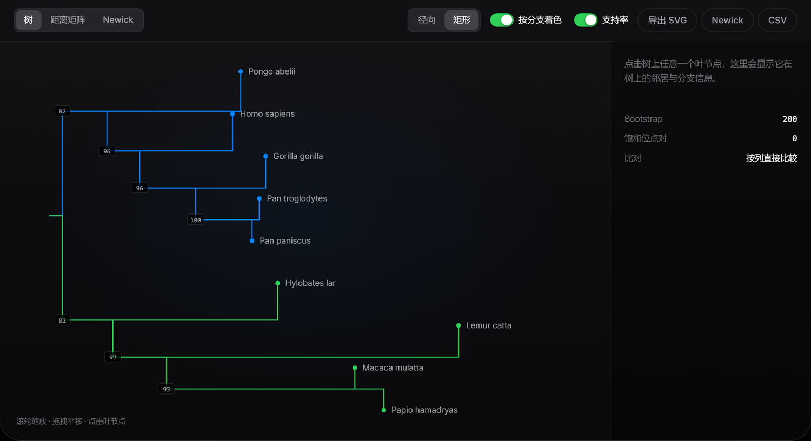
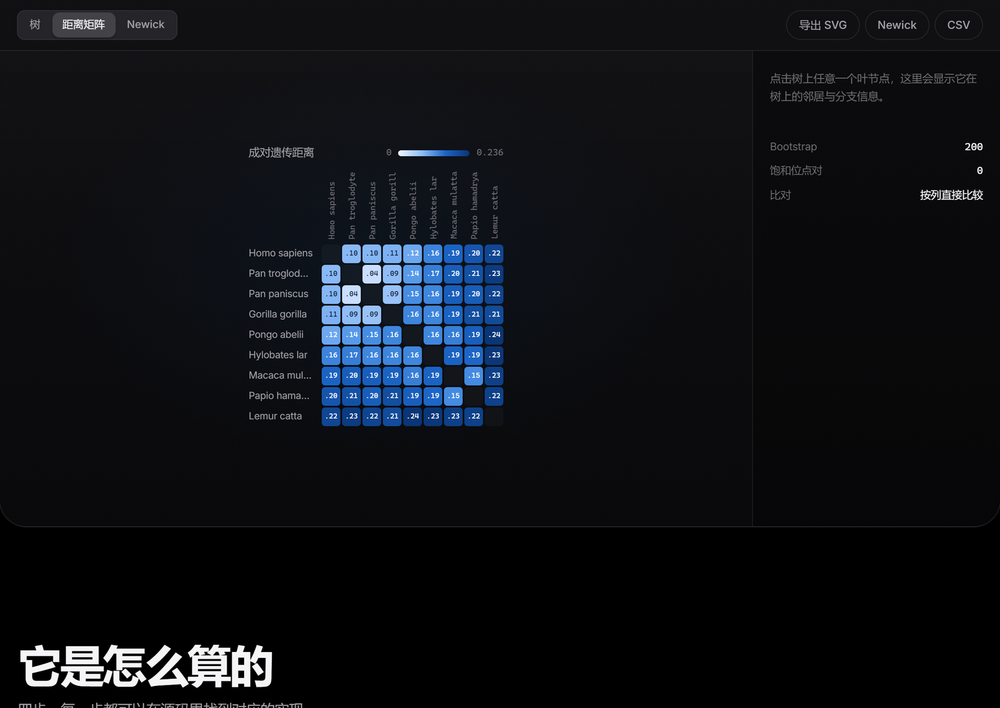

<div align="center">

# Phylo Studio

**从一段 DNA，长出一棵树。**

一个完全在浏览器里运行的系统发生树工作室。粘贴 FASTA，选择距离模型与建树算法，
实时得到一棵可缩放、可探索、可导出的进化树。

[**在线使用**](https://haomiaoyan.github.io/phylo-studio/) · [算法说明](#它是怎么算的) · [数据来源](#数据与边界)

<sub>MIT License · 纯前端 · 无需注册 · 序列不会离开你的电脑</sub>

</div>


---

## 它是什么

系统发生树（phylogenetic tree）是生物信息学里最基础也最有画面感的产物之一：把一组
序列的差异压缩成一棵分支结构，让「谁和谁更近」变成可以一眼看出的形状。

Phylo Studio 把这条链路完整地放在浏览器里：

- **输入**：粘贴 FASTA，或导入 `.fa` / `.fasta` / `.txt` 文件，或直接用内置的真实数据集。
- **计算**：解析 →（必要时）逐对全局比对 → 遗传距离矩阵 → 建树 → Bootstrap → 布局。
- **输出**：一棵可以缩放、拖拽、点击的树；距离矩阵热力图；Newick 文本；可导出的 SVG / Newick / CSV。

所有计算跑在 Web Worker 里，主线程不卡；页面本身是一个静态站点，没有后端，没有账户，
没有埋点。

## 功能

| 能力 | 说明 |
| --- | --- |
| 解析 FASTA | 容忍纯文本、行号、空白、小写、`U`（转录成 `T`）、IUPAC 简并与 `-` gap（记为未知位点并计数） |
| 长度不齐时自动比对 | 用 Needleman–Wunsch 全局比对逐条对齐到参考序列，gap 记为未知位点，不参与距离计算 |
| 三种距离模型 | `p-distance`、`Jukes–Cantor`、`Kimura 2-parameter`（区分转换/颠换） |
| 两种建树算法 | Neighbor-Joining（不假设分子钟）、UPGMA（假设所有谱系速率相同） |
| Bootstrap | 0–1000 次列重采样，支持率标注在内部节点上（<100 才显示） |
| 两种布局 | 径向（放射状）与矩形（层级） |
| 交互 | 滚轮缩放、拖拽平移、点击叶节点查看根距与最近邻居、悬停高亮 |
| 导出 | SVG（矢量）、Newick（.nwk）、距离矩阵 CSV |
| 移动端 | 树与矩阵都会按容器宽度自适应，窄屏下矩阵不裁切 |

## 界面


径向视图适合看整体结构：分支按所属演化支着色，Bootstrap 支持率以胶囊标签标在内部节点上，
叶标签沿半径方向排布并自动翻转到朝外的一侧。



矩形视图适合读层级：叶节点按可用高度均分，短树不会挤在顶部。



距离矩阵是同一份数据的另一种读法：颜色越深表示遗传距离越大，悬停任意单元格会高亮它
所在的行与列，方便横向比较。


## 它是怎么算的

四步，每一步都能在源码里找到对应的实现。

### 01 解析与比对 — `src/lib/fasta.ts`、`src/lib/distance.ts`

`parseSequences` 把文本切成记录：忽略行号与空白，统一大写，`U→T`，非 `ACGT` 的 IUPAC
简并与 gap 一律记作未知位点并计入警告。没有 `>` 头的文本会被当成单条序列。重名会自动
去重成 `name_2`。

如果所有序列等长，按列直接比较（快，也是真实条形码数据的常态）。长度不齐时，用
Needleman–Wunsch 全局比对（match +2 / mismatch −1 / gap −2）把每条序列逐一对齐到前一条，
空位记为未知位点，**不参与距离计算** —— 宁可少算一列，也不凭空造一个差异。

### 02 遗传距离 — `src/lib/distance.ts`

对每一对序列，只在双方都有确定碱基的列上统计：

- **p-distance**：差异位点数 / 有效位点数，最直白，也最不校正。
- **Jukes–Cantor**：`d = -3/4 · ln(1 - 4/3 · p)`，假设四种碱基替换等概率。
- **Kimura 2P**：`d = -1/2 · ln(1 - 2P - Q) - 1/4 · ln(1 - 2Q)`，把转换（P）与颠换（Q）分开校正。

p 接近饱和时公式会发散。这里不做钳制，而是**标记出来**：JC 饱和返回哨兵值 3，K2P 返回 10，
并在统计条上显示「饱和位点对」的数量。宁可给你一个明显的异常值，也不悄悄给一个假的数字。

### 03 聚类建树 — `src/lib/tree.ts`

- **Neighbor-Joining**：逐步合并使总枝长最小的类群，不假设分子钟，是距离法里的默认选择。
- **UPGMA**：用平均连接，假设所有谱系演化速率相同，输出严格等距的超度量树。

两者都输出带枝长的二叉树。枝长就是遗传距离，单位是「每位点替换数」。

### 04 Bootstrap — `src/lib/tree.ts`

对列做有放回重采样，重复建树，统计每个分支（split）在多少比例的重采样里重新出现。
支持率只画在内部节点上，且只在小于 100 时显示 —— 100 是默认值，写出来反而噪音。
重复次数为 0 时跳过这一步。

> **关于「准确性」的诚实说明**
>
> 这里实现的是教学与研究常用的经典算法，不是完整的系统发生推断套件：没有最大似然、
> 没有贝叶斯、没有分区模型、没有 gamma 速率异质性。它足够把一个概念讲清楚，也足够对
> 真实序列给出一个合理的初步结构；但它不能替代 IQ-TREE、RAxML 或 MrBayes 在发表级分析
> 中的位置。

## 数据与边界

内置的两组示例是**真实序列**，不是编造的数字：

| 数据集 | 分类单元 | 位点 | 来源 |
| --- | --- | --- | --- |
| 脊椎动物 · COI 条形码 | 16 | 648 bp | NCBI RefSeq 线粒体基因组 COX1 (COI) CDS |
| 灵长类 · COI 条形码 | 9 | 648 bp | 同上 |

- 每条序列都是对应物种线粒体 RefSeq 基因组里的 COX1 编码区，截取 5′ 端 648 nt —— 也就是
  DNA 条形码常用的 Folmer 区段。每个叶节点的学名、中文名与登录号都记录在
  `src/data/datasets.json` 里，可以逐条核对。
- 抓取日期与完整登录号写在 `src/data/datasets.json` 里；重新抓取可以跑
  `node scripts/fetch-datasets.mjs`。
- 默认展示灵长类数据集，因为它规模适中、Bootstrap 支持率分布好看，首屏更容易读懂。
  切到脊椎动物数据集能看到更深的分歧（鱼、昆虫、植物被正确分到不同的大分支）。

边界也很明确：

- 一次最多 **200 条**序列 —— 距离矩阵是 O(n²)，Bootstrap 还会再乘一个常数。
- 长度不齐时的逐对渐进比对只是为了让流程能跑通，**不是**多序列比对（MSA）的替代品。
  严肃分析请先用 MAFFT / MUSCLE 对齐好再粘进来。
- 距离法本身会丢失信息：它只看两两差异，不做似然。树上的 Bootstrap 值反映的是
  「这批列支不支持这个分支」，不是「这个分支为真的概率」。

## 快速开始

```bash
git clone https://github.com/haomiaoyan/phylo-studio.git
cd phylo-studio
npm install
npm run dev        # http://localhost:5173/phylo-studio/
```

其他脚本：

```bash
npm run build      # tsc --noEmit && vite build
npm run preview    # 预览 dist
npm test           # vitest run（31 个单元测试）
npm run typecheck  # 只做类型检查
```

需要 Node 18 以上（CI 使用 Node 22）。

## 技术栈

- **Vite 6** + **React 18** + **TypeScript**（strict，`noUnusedLocals` / `noUnusedParameters`）
- **Vitest** 做纯函数单元测试：解析、距离模型、UPGMA/NJ、Newick 序列化与解析往返
- **零 UI 框架**：所有组件与样式手写，CSS 变量驱动的设计系统（`src/styles.css`）
- **Web Worker** 承载全部计算，主线程只负责画
- 字体 `@fontsource-variable/inter` 本地打包，不请求第三方 CDN
- 部署走 GitHub Actions → GitHub Pages（`.github/workflows/deploy.yml`）

```
src/
├── lib/            # 纯函数：解析、距离、建树、布局、导出（全部有单测覆盖）
├── components/     # TreeCanvas / DistanceMatrix / Controls / NeighbourList
├── worker/         # 计算线程
├── data/           # 真实 NCBI 数据集与格式化
├── App.tsx         # 页面与状态编排
└── styles.css      # 设计系统
```

## 设计说明

界面刻意向 Apple 的设计语言靠拢：纯黑背景、hairline 分隔线、大字号紧字距的标题、
毛玻璃导航、胶囊按钮、分段控件、克制的动效（并尊重 `prefers-reduced-motion`）。
颜色只承担语义：蓝色是主操作与「人科」分支，绿色是「其他灵长类」，其余演化支用同一套
深色调色板区分。

## 许可证

[MIT](LICENSE)。算法实现可以随便拿去改，示例序列的版权归 NCBI / 各原始数据提交者。
